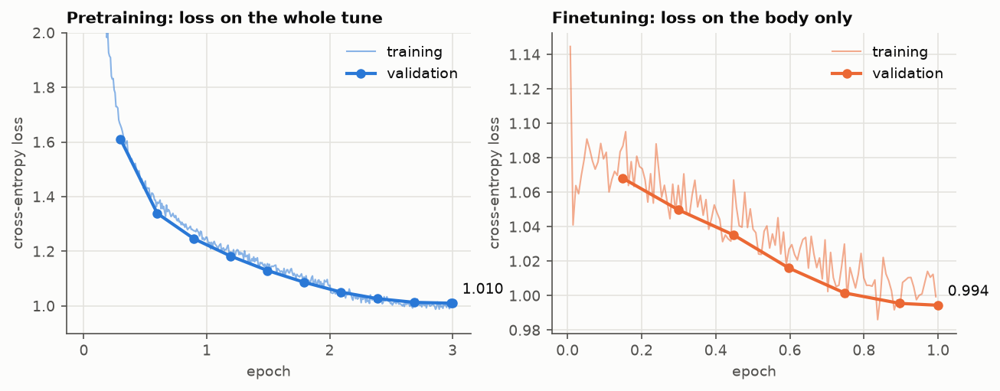
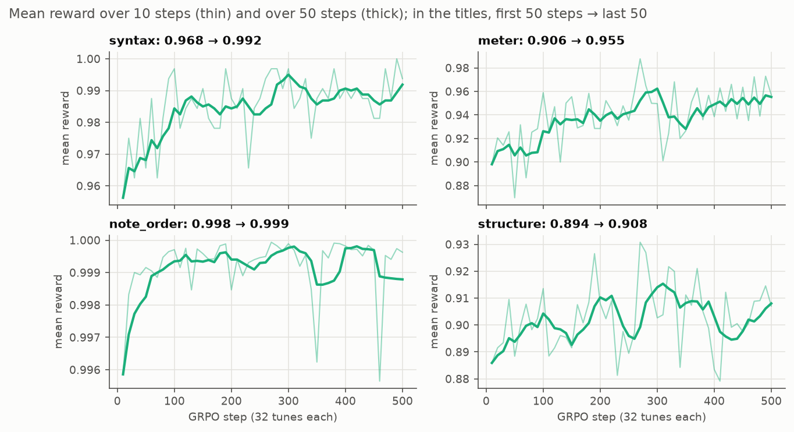
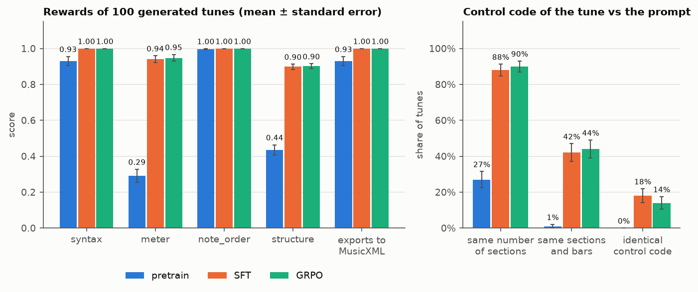

# abc-gpt

[](LICENSE)
[](https://huggingface.co/matteospanio/abc-gpt)
[](#demo-and-mcp-server)

A small GPT-2 (26.8M parameters) trained from scratch to write Irish folk tunes in
[ABC notation](https://abcnotation.com/wiki/abc:standard:v2.1). It is first pretrained on raw ABC
text, then finetuned to follow a *control code* that sets the structure of the tune (number of sections,
bars per section, similarity between sections), then trained with GRPO on rewards computed with
[music21](https://web.mit.edu/music21/). It is companion code for a presentation on the Hugging Face
ecosystem, so every stage uses a library from that stack:

| Stage | What it does | Hugging Face tool |
|:--|:--|:--|
| `prepare` | trains a BPE tokenizer, builds a GPT-2 with random weights | `datasets`, `tokenizers`, `transformers` |
| `data` | cleans IrishMAN and writes the dataset of every later stage | `datatrove` |
| `pretrain` | next-token prediction on raw ABC text | `trl sft` |
| `finetune` | control code + header → tune body (loss on the completion only); LoRA optional | `trl sft`, `peft` |
| `grpo` | reinforcement learning with four rewards computed with music21 | `trl grpo` |
| `evaluate` | compares the checkpoints on the rewards, exports the tunes to MusicXML | `transformers` |
| `export` | GGUF file for llama.cpp | `convert_hf_to_gguf.py` |
| `demo` | web app and MCP server that compose a tune, draw the score and play it | `gradio` |

The trained weights of the three stages are on the Hub:
[matteospanio/abc-gpt](https://huggingface.co/matteospanio/abc-gpt) (GRPO model at the root, `sft/`,
`pretrain/`, and a GGUF file). Training curves, evaluation and speed are in [Results](#results).

## Using the model

The prompt is the control code in an ABC comment line, followed by the tune header; the model writes
the body and stops at its end-of-text token.

```python
from transformers import AutoModelForCausalLM, AutoTokenizer

tokenizer = AutoTokenizer.from_pretrained("matteospanio/abc-gpt")
model = AutoModelForCausalLM.from_pretrained("matteospanio/abc-gpt")  # subfolder="sft" or "pretrain" for the earlier stages

prompt = "%S:2 B:8 E:5 B:8\nX:1\nL:1/8\nM:6/8\nK:D\n"  # a jig in D: 2 sections of 8 bars, the second 50% similar to the first
inputs = tokenizer(prompt, return_tensors="pt")
out = model.generate(**inputs, do_sample=True, temperature=1.0, max_new_tokens=512,
                     pad_token_id=tokenizer.pad_token_id)
print(prompt + tokenizer.decode(out[0, inputs["input_ids"].shape[1]:], skip_special_tokens=True))
```

Use sampling: with greedy decoding a prompt always gives the same tune, and a repetitive one. The
[model card](https://huggingface.co/matteospanio/abc-gpt) has the prompt format and the commands for
llama.cpp.

## Demo and MCP server

```bash
./run.sh demo               # http://127.0.0.1:7860
```

The Gradio app takes meter, key, control code and temperature, generates a tune on the server, and
draws and plays it in the browser with [abcjs](https://paulrosen.github.io/abcjs/). It also offers the
MusicXML file (for MuseScore and similar editors) and the control code of the generated tune with its
`structure` reward, to compare with the one you asked for.

The same app is an [MCP](https://modelcontextprotocol.io) server (`launch(mcp_server=True)`): its
`compose` function is a tool that an LLM client can call. The endpoint is
`http://127.0.0.1:7860/gradio_api/mcp/` (streamable HTTP). For example, with Claude Code:

```bash
claude mcp add --transport http abc-gpt http://127.0.0.1:7860/gradio_api/mcp/
```

Gradio builds the tool description from the docstring of `compose` (`src/abcgpt/app.py`), one line per
parameter in Google style: that text is all the LLM knows about meter, key, control code and
temperature, so keep it precise.

## Setup

```bash
uv sync --extra demo        # Python 3.12, PyTorch with CUDA from PyPI
uv run pytest               # rewards and data filter, ~15 s
uv run wandb login          # once, for the training curves (see Logging)
```

## Running

```bash
./run.sh prepare            # <1 min on CPU: tokenizer and random model in models/gpt2-abc-init
./run.sh data               # ~2 min on 8 CPU cores: DataTrove pipeline, writes data/
./run.sh pretrain           # models/gpt2-abc-pretrain
./run.sh finetune           # models/gpt2-abc-sft
./run.sh grpo               # models/gpt2-abc-grpo
./run.sh evaluate           # reward table + outputs/<checkpoint>/*.musicxml
./run.sh demo               # http://127.0.0.1:7860
uv run python -m abcgpt.plots   # the charts of this README, in docs/
```

`./run.sh STAGE --quick` runs a few hundred steps instead of the full schedule, to check the whole
chain in minutes. Any other argument overrides the stage's YAML file:

```bash
./run.sh pretrain --learning_rate 3e-4 --num_train_epochs 1
./run.sh finetune --use_peft true --lora_r 8
./run.sh grpo --quick --num_generations 4 --max_completion_length 256
```

On a GPU without bfloat16 (before Ampere) add `--bf16 false`.
With `--use_peft true` the output folder holds only the LoRA adapter; `transformers` loads it on top of
the base model named in `adapter_config.json`, so `evaluate` and `demo` read it as it is (GRPO from an
adapter is not tested). The time of each stage is in [Results](#training).

## How it works

A tune in ABC is plain text: a header of `field:value` lines (`X:` number, `M:` meter, `L:` unit note
length, `K:` key, which always comes last) and a body with the notes, where `|` separates bars and
`|:` / `:|` mark repeats. This is a tune of the IrishMAN validation split, with its control code:

```
%S:2 B:5 E:6 B:5                       ← control code (an ABC comment): the prompt starts here
X:185
L:1/8
M:4/4
K:Bmin                                 ← end of the header and of the prompt
|: B3 c dBAF | B3 c dfed | B3 c dcdB |1 ABde fded :|2 ABde fdec |: dfaf bfaf | dfaf g2 fg |
 afge d3 B |1 ABde fdec :|2 ABde fded |]                       ← the body: what the model writes
```

`S:2` says the tune has 2 sections, then each section has its bars (`B:5`) and, from the second one on,
one `E:` per earlier section: how similar the two are, from 0 (different) to 10 (the same). Here the
second section is 60% similar to the first. The codes come from
[TunesFormer](https://ceur-ws.org/Vol-3528/paper1.pdf), which annotated the
[IrishMAN](https://huggingface.co/datasets/sander-wood/irishman) dataset with them (214,122 training
and 2,162 validation tunes, MIT licence).

The model learns in three stages. Pretraining teaches it ABC: it reads whole tunes and predicts the
next token. Finetuning teaches it to read the control code: it gets code and header and writes the
body. GRPO then makes it generate tunes, scores them with rules written in Python and pushes it
towards the better ones. Each stage starts from the weights of the previous one.

### 1. Tokenizer and model (`prepare`)

**What.** A tokenizer made for English (like GPT-2's, with 50,257 tokens) splits ABC into odd pieces.
A byte-level BPE trained on the IrishMAN tunes learns the units of this text instead: bar lines,
repeats, notes with their lengths, frequent groups of notes. 2,048 tokens are enough, and a smaller
vocabulary means a smaller embedding matrix. Byte-level means every byte has a token, so any text can be
encoded and there is no "unknown" token. The model is a GPT-2 with 8 layers of width 512 and random
weights: 26.8M parameters, a size that one GPU trains in a few hours on this data.

**Implementation** (`src/abcgpt/prepare.py`). `train_tokenizer` builds a `tokenizers` BPE model with the
`ByteLevel` pre-tokenizer and decoder of GPT-2 and trains it on the `abc notation` column of IrishMAN,
loaded with `datasets.load_dataset`. `<|endoftext|>` (id 0) is both start and end of text, `<pad>`
(id 1) the padding. The tokenizer is wrapped in a `PreTrainedTokenizerFast` and saved next to a
`GPT2LMHeadModel` built from a `GPT2Config`, in `models/gpt2-abc-init`: the folder that `trl sft` loads
as `model_name_or_path`. `n_ctx` is saved explicitly because llama.cpp's converter reads it. The
training of the tokenizer is deterministic, so every run and every model size gets the same tokenizer.

### 2. Data pipeline (`data`)

**What.** Some IrishMAN tunes would teach the model wrong things or could not be learned whole, so the
stage drops them, then writes each dataset in the form its trainer expects: whole tunes for
pretraining, prompt and completion for finetuning, prompts only for GRPO and evaluation.

**Implementation** (`src/abcgpt/data.py`, settings in `configs/data.yaml`). One
[DataTrove](https://github.com/huggingface/datatrove) pipeline per split:

```
HuggingFaceDatasetReader → ABCFilter → JsonlWriter (pretrain) → JsonlWriter (finetune)
                                     → SamplerFilter → JsonlWriter (grpo or eval prompts)
```

`ABCFilter` drops a tune when:

- it has no body after the `K:` line (`no_body`);
- music21's ABC tokenizer cannot read some symbol (`unreadable`): it warns and guesses a C note;
- it is longer than `max_tokens` (512) once the control code is added (`too_long`). `trl` would cut it to
  `max_length` and the model would never see its end; it needs the tokenizer, so `prepare` runs first.

Writers pass every document on, so one pass writes all the outputs, each with its own *adapter* (the
function that turns a DataTrove `Document` into a JSON line):

| Folder | Content | Used by |
|:--|:--|:--|
| `data/pretrain/{train,validation}` | kept tunes, original IrishMAN columns | `pretrain` |
| `data/finetune/{train,validation}` | `prompt` (control code + header), `completion` (body) | `finetune` |
| `data/grpo` | prompts of 2.5% of the training tunes | `grpo` |
| `data/eval` | prompts of 10% of the validation tunes | `evaluate` |
| `data/removed/<split>` | dropped tunes, reason in `metadata.filter_reason` | you |
| `data/logs/<split>` | DataTrove logs, statistics of every step, completed tasks | you |

Result on IrishMAN (train): 209,568 tunes kept out of 214,122; 1,580 unreadable, 2,959 too long, 15 without
a body; 5,321 GRPO prompts. The statistics are printed at the end and saved in `data/logs/<split>/stats.json`.

Each split is cut into `tasks` shards processed in parallel. A second run skips the tasks already
completed, so an interrupted run resumes; delete `data/` to start over (needed after changing a filter).
With `--slurm_partition <name>` the same pipeline is submitted as a Slurm job array per split
(`--tasks 64` for more parallelism), from the environment `run.sh` uses.

### 3. Pretraining (`pretrain`)

**What.** Next-token prediction on whole tunes, header and body, without the control code: the model
learns the syntax of ABC and the style of the tunes. It sees every tune 3 times.

**Implementation** (`configs/pretrain.yaml`). A plain `trl sft` run on the `abc notation` column of
`data/pretrain`: no training loop is written here. Batch of 32 tunes, learning rate 6e-4 with 500
warmup steps and cosine decay, weight decay 0.1, bf16. `packing: false` because with GPT-2 and SDPA
attention packed tunes could attend to each other. `train_sampling_strategy: group_by_length` builds
batches of tunes of similar length: they range from ~50 to 512 tokens, so random batches spend much of
the compute on padding.

### 4. Finetuning on the control code (`finetune`)

**What.** The model now gets the control code and the header and writes the body. The loss counts only
the body, so the model is not trained to write control codes, only to follow them. Since the control
code is an ABC comment, the full text stays a valid tune that every ABC tool reads.

**Implementation** (`configs/finetune.yaml`). Another `trl sft` run, on `data/finetune`: a dataset
with `prompt` and `completion` columns is what makes TRL mask the prompt in the loss. One epoch, batch 32,
cosine schedule with 200 warmup steps. `--use_peft true` trains a LoRA adapter (`peft`, rank 16 on
`c_attn`, `c_proj`, `c_fc`) instead of all the weights. The published SFT checkpoint was trained with
`--learning_rate 2e-4`; the YAML file now has 5e-5, because at 2e-4 the training loss first goes back
up (see [Training](#training)).

### 5. GRPO with music rewards (`grpo`)

**What.** [GRPO](https://arxiv.org/abs/2402.03300) (Group Relative Policy Optimization) samples a group
of 8 tunes for each prompt, scores each one, and compares it with the others of its group: the tunes
that score above the group mean become more likely, those below less likely. The score is a weighted
sum of Python functions, so there is no reward model to train and no value model as in PPO. With
`beta: 0` there is no penalty for moving away from the SFT model, which saves keeping a second copy in
memory.

**Implementation** (`configs/grpo.yaml`, `src/abcgpt/rewards.py`). A plain `trl grpo` run on the prompts
of `data/grpo`: 500 steps of 32 tunes (4 prompts × 8 tunes, in batches of 8 tunes × 4 accumulation
steps), learning rate 1e-5, temperature 1.0, up to 512 new tokens, so no tune is cut. `reward_funcs` lists four functions as
dotted paths (`abcgpt.rewards.syntax`) with `reward_weights: [1.0, 1.0, 0.5, 1.0]`; TRL calls each with
the generated `completions` and their `prompts` and logs each reward on its own. The first three judge
the form of the ABC; the last one whether the tune follows the control code that finetuning taught the
model to read:

- `syntax`: 1 if music21 parses the tune without warnings and finds notes. music21 is lenient (it reads an
  unknown symbol as a C and only warns), so a warning counts as an error.
- `meter`: share of inner bars (not the first, which may be a pickup, nor the last) whose length matches
  `M:` and `L:`. Tuplets are scaled; a short bar next to a repeat or a double bar counts as correct.
- `note_order`: share of notes written in the canonical order accidental–pitch–octave–length
  (`^c'2`, not `c^2` or `2c`).
- `structure`: how close the tune is to the control code of its prompt. The code of the generated tune
  is computed by `control_code`, a port of the TunesFormer script that annotated IrishMAN
  (`add_control_codes.py`): sections end at `[|`, `||`, `|]`, `|:`, `::`, `:|` (a second ending `:|2`
  stays in its section), `B` counts the bars of each section, and each section has one `E` per previous
  section, `round(10 × (1 − Levenshtein / longer length))`. The score is the mean of three terms, each
  1 − relative error: number of sections, bars of each section, similarities (out of 10).

Parsing with music21 is the slow part, so `syntax` runs in a pool of 8 forked processes. On about 1% of
the tunes written by an untrained model music21 never returns: after `PARSE_TIMEOUT` (2 s of CPU time,
so a busy machine does not cause false timeouts; real tunes take at most 0.6 s) the tune scores 0.
Forked workers inherit every open file descriptor, so a server must start the pool before it opens its
sockets: the demo calls `syntax` once at startup for this reason.

The rewards were checked on validation tunes and on corrupted copies:

| | syntax | meter | note_order |
|:--|--:|--:|--:|
| real tunes | 0.997 | 0.951 | 1.000 |
| random characters | — | 0.607 | — |
| some notes removed from bars | — | 0.664 | — |
| length written before the pitch | — | — | 0.951 |
| output of a barely trained tiny model | 0.10 | 0.37 | 0.90 |

`note_order` is a weak signal (most generated notes are already in order): it has the lowest weight.
`meter` is the one that separates real tunes from plausible-looking ones.

`control_code` gives the same code as the dataset for all 2,162 validation tunes and for 99.94% of 5,000
training tunes. Against their own code real tunes score `structure` = 1.000; against the code of another
random tune 0.545 (0.826 when the number of sections happens to match).

### 6. Evaluation (`evaluate`)

**What.** Every checkpoint writes one tune for each of the same validation prompts, with the same seed;
the four rewards measure the tunes, and the tunes that parse are exported to MusicXML to open them in a
score editor.

**Implementation** (`src/abcgpt/evaluate.py`, `configs/evaluate.yaml`). Batched sampling with left
padding (`padding_side="left"`, so all the prompts end where generation starts), at temperature 1.0.
For each checkpoint it writes `outputs/<checkpoint>/tunes.jsonl` (tune, its own control code, the four
rewards) and `tune_NNN.musicxml`, and prints a table of the means. `src/abcgpt/plots.py` draws the
charts of [Results](#results) from these files and from the `trainer_state.json` of the last checkpoint
of each training run.

### 7. GGUF export (`export`)

**What.** A GGUF file runs the model with [llama.cpp](https://github.com/ggml-org/llama.cpp) and the
runtimes built on it, without Python; on CPU it is about 4 times faster than `transformers`
([speed](#inference-speed)).

**Implementation** (`src/abcgpt/export_gguf.py`, `configs/export.yaml`):

```bash
git clone https://github.com/ggml-org/llama.cpp
LLAMA_CPP_DIR=llama.cpp ./run.sh export            # models/gpt2-abc-grpo.gguf, F16
llama completion -m models/gpt2-abc-grpo.gguf -p '%S:2 B:8 E:5 B:8\nX:1\nL:1/8\nM:6/8\nK:D\n' -e \
  -n 512 --temp 1.0 --top-k 0 --top-p 1.0 --min-p 0.0
```

The script calls llama.cpp's own converter. That converter recognises a BPE tokenizer by hashing how it
encodes a test string, and a tokenizer trained here is not in its list. Ours uses the same byte-level
pre-tokenizer as GPT-2, so the script tells the converter so. llama.cpp pins its own versions of
`transformers` and `torch`: if the import fails, run the export in an environment made with
`pip install -r llama.cpp/requirements.txt` plus this package.

`llama` is the command-line tool of llama.cpp (tested with build 12182). Run the model with
`completion` (plain continuation), not the chat interface. Give the prompt with `-p`
and `-e`: with `-f` llama.cpp drops the final newline of the file, and the model was trained on headers
that end with one. `--top-k 0 --top-p 1.0 --min-p 0.0` turn off llama.cpp's default filters and give the
plain sampling used everywhere else here.

## Results

The numbers of the published checkpoints, trained on one GPU of a Slurm cluster, in bf16, on an earlier
output of the data stage: the step counts (6,692 batches of 32 per pretraining epoch, 6,691 in
finetuning) correspond to all the 214,122 training tunes for pretraining and the 214,107 with a body for
finetuning, without the `unreadable` and `too_long` filters.

### Training



| Stage | Steps | Time | Validation loss |
|:--|--:|--:|:--|
| pretraining | 20,076 (3 epochs) | 1 h 43 min | 1.610 (step 2,000) → 1.010 |
| finetuning | 6,691 (1 epoch) | 37 min | 1.068 (step 1,000) → 0.994 |
| GRPO | 500 | 23 min | — (mean reward 3.27 → 3.36) |

The two losses are not comparable: pretraining counts every token of the tune, header included,
finetuning only the body. In the third epoch of pretraining the training loss drops below the
validation loss, and the validation loss is almost flat (1.013 at step 18,000, 1.010 at the end): 3
epochs are about the limit for this size. In finetuning, the training loss first rises from 1.04 to 1.09 while the
learning rate warms up to 2e-4 (pretraining ended with a learning rate close to 0), then falls; the
validation loss falls all along.

### GRPO



All four rewards rise, from the first 50 steps to the last 50: `syntax` 0.968 → 0.992, `meter`
0.906 → 0.955, `note_order` 0.998 → 0.999, `structure` 0.894 → 0.908. Each panel has its own vertical
scale: `note_order` moves by 0.001 only.

### Evaluation

`./run.sh evaluate` with its defaults: 100 tunes per checkpoint, the first 100 of the 176 prompts in
`data/eval` (validation split), temperature 1.0, seed 42, on CPU. On the left the mean of each reward
and the share of tunes that music21 exports to MusicXML; on the right how often the control code of the
generated tune matches the one in its prompt.



Finetuning makes the difference: the pretrained model never saw a prompt that starts with a control
code. Its tunes still parse (`syntax` 0.930), but their bars do not match the meter (`meter` 0.292) and
their structure is far from the one asked (`structure` 0.435). GRPO adds little
on these prompts: the SFT model already scored close to 1 on `syntax` and `note_order`, and its gains on
`meter` (+0.007) and `structure` (+0.004) are smaller than the standard error of these means over 100
tunes (0.015–0.019, the error bars): SFT and GRPO score 0.941 and 0.948 on `meter`, 0.898 and 0.902
on `structure`. The control code is followed approximately: the number of sections is right in 90% of
the tunes, the bars of every section in 44%, the whole code in 14%.

### Inference speed

On a laptop CPU (Intel Core Ultra 5 226V, 4 threads), a tune of about 100 tokens takes:

| Runtime | Tokens per second | Time per tune |
|:--|--:|--:|
| `transformers` (float32) | about 180 | about 0.4 s |
| llama.cpp (`gpt2-abc-grpo.gguf`, F16) | about 770 | about 0.1 s |

With `transformers` more threads are slower for a model this small: 8 threads give about 110 tokens
per second, 2 to 4 give 175–186. The demo therefore uses half the CPU cores. It is ready 6 s after
launch, and a Compose (generation, rewards, MusicXML export) takes 0.6–1.3 s.

### GGUF check

The F16 GGUF file gives the same model as the float32 weights: loaded back in `transformers`
(`gguf_file=`), it has the same tokens and its logits differ by at most 0.0025, with the same most
likely token. In llama.cpp (build 12182) the prompt is split into the same tokens as in `transformers`,
and 5 tunes out of 5 scored 1.0 on `syntax`, `meter` and `note_order` and 0.9–1.0 on `structure`, all
ending at the end-of-text token.

## Configuration

Every stage reads a YAML file in `configs/` and accepts command-line overrides, through the parser
that TRL already uses (`TrlParser`, an extension of `transformers.HfArgumentParser`):

- `pretrain`, `finetune` and `grpo` are plain `trl sft` / `trl grpo` runs: the YAML files hold fields of
  `SFTConfig` / `GRPOConfig` (all of `TrainingArguments`), `ModelConfig` (model path, dtype, LoRA) and
  `ScriptArguments` (dataset). No training loop is written here.
- `prepare`, `evaluate`, `export`, `demo` and `plots` are our scripts, each with a small dataclass parsed
  the same way (`python -m abcgpt.prepare --config configs/prepare.yaml --vocab_size 4096`).

The values actually used end up in `output_dir/training_args.bin`.

### Logging with Weights & Biases

`pretrain`, `finetune` and `grpo` log to [W&B](https://wandb.ai) (`report_to: wandb` in their YAML
files), one run per stage (`run_name`) in the project `abc-gpt`. The GRPO run also logs the reward of
each function and, with `log_completions: true`, a table with prompts, generated tunes and rewards.

| To | Do |
|:--|:--|
| disable it | `--report_to none`, or `WANDB_MODE=disabled ./run.sh …` |
| use another backend | `--report_to tensorboard` (or `trackio`) |
| change project or team | `WANDB_PROJECT=my-project WANDB_ENTITY=my-team ./run.sh …` |
| run without network | `WANDB_MODE=offline ./run.sh …`, then `uv run wandb sync wandb/offline-run-*` |
| upload the final model | `WANDB_LOG_MODEL=end ./run.sh …` |

Project, team and mode are environment variables because that is how the `transformers` integration
reads them; `run.sh` only sets the default project.

Hydra would add composition of config groups and sweeps (`-m learning_rate=1e-4,3e-4`); here it would
be a second format next to the one TRL already reads, so it is not used.

## Slurm

```bash
./run.sh prepare                                   # on a login node: needs internet access
./run.sh data                                      # here, or: ./run.sh data --slurm_partition <cpu partition>
sbatch slurm/train.sbatch pretrain                 # then finetune, then grpo
sbatch --gres=gpu:2 slurm/train.sbatch grpo --max_steps 1000
```

`slurm/train.sbatch` uses all the GPUs of one node: it passes `--num_processes` (and `--multi_gpu`) to
`trl`, which hands them to `accelerate launch`. Set partition and account in the `#SBATCH` lines
(`sbatch --cpus-per-task=8 --partition=<name>` overrides them without editing the file).
Compute nodes often have no internet, so the script sets `HF_HUB_OFFLINE=1`: training reads only the
local `data/` folder. If `data` runs on Slurm, its jobs read IrishMAN from the cache filled by `prepare`
(set `HF_HOME` if the cache is on a shared filesystem, and `HF_HUB_OFFLINE=1` before `./run.sh data`). For the same reason
W&B runs offline (`WANDB_MODE=offline`, unless set before `sbatch`): sync them from the login node with
`uv run wandb sync wandb/offline-run-*`. The batch sizes in the YAML files are per GPU.

## Scaling the model

The default GPT-2 (8 layers, 512 dimensions) uses about 3.3 GB on an 8 GB GPU. The free memory is not
the real limit: IrishMAN gives about 35M tokens per epoch, so in 3 epochs the model sees ~4 tokens per
parameter (the compute-optimal ratio of Chinchilla is ~20). A larger model reaches a lower training loss
but overfits sooner on repeated data (in the third epoch above the validation loss already flattens), so measure before
changing the default:

| Size | layers × dim (heads) | Parameters | VRAM at batch 32 | Time vs S |
|:--|:--|--:|--:|--:|
| S (default) | 8 × 512 (8) | 26.8M | 3.3 GB (measured) | 1× |
| M | 12 × 640 (10) | 61.1M | ~6 GB (estimate) | ~2.3× |
| L | 12 × 768 (12) | 87.4M | ~7+ GB (estimate) | ~3.4× |

```bash
for size in "m 12 640 10" "l 12 768 12"; do
  set -- $size
  ./run.sh prepare --model_dir models/gpt2-abc-init-$1 --n_layer $2 --n_embd $3 --n_head $4
  ./run.sh pretrain --model_name_or_path models/gpt2-abc-init-$1 \
    --output_dir models/gpt2-abc-pretrain-$1 --run_name pretrain-$1
done
```

Every size gets the same tokenizer and the data from `./run.sh data` is shared, so the losses are
comparable. On out-of-memory errors add `--per_device_train_batch_size 16 --gradient_accumulation_steps 2`
(same effective batch) or `--gradient_checkpointing true` (about 30% slower).

Then compare `pretrain`, `pretrain-m` and `pretrain-l` in W&B. If `eval/loss` is still going down at the
end and stays close to `train/loss`, the larger model is worth it. If `eval/loss` flattens or rises in
the third epoch while `train/loss` keeps falling, it is overfitting: use fewer epochs or the smaller
size. Continue with the winner through `--model_name_or_path models/gpt2-abc-pretrain-m` in `finetune`,
or change `n_layer`, `n_embd` and `n_head` in `configs/prepare.yaml`.

## Layout

```
configs/                  one YAML file per stage
src/abcgpt/prepare.py     tokenizer and random GPT-2
src/abcgpt/data.py        DataTrove pipeline: filters and datasets of every stage
src/abcgpt/rewards.py     syntax, meter, note_order, structure (and control_code)
src/abcgpt/evaluate.py    reward table and MusicXML export
src/abcgpt/plots.py       the charts in docs/, from the training logs and the evaluation
src/abcgpt/export_gguf.py GGUF conversion
src/abcgpt/app.py         Gradio demo and MCP server, score drawn and played by abcjs in the browser
slurm/train.sbatch        one node, all its GPUs
tests/test_rewards.py     real tunes vs corrupted ones
tests/test_data.py        what ABCFilter keeps and drops
run.sh                    one entry point for all the stages
```

## Related work

- [NotaGen](https://github.com/ElectricAlexis/NotaGen) generates classical scores in ABC with the
  same three phases at a larger scale: pretraining on 1.6M pieces, finetuning on ~9k pieces conditioned
  on period, composer and instrumentation, then reinforcement learning (CLaMP-DPO, which uses a
  music-text model as judge instead of rules). Its model is a hierarchical GPT-2 (one level per bar, one
  per character) with a custom training loop.
- [MuPT](https://huggingface.co/m-a-p/MuPT-v1-8192-190M) is a family of Llama models pretrained on ABC
  (Apache-2.0). Starting `finetune` from MuPT instead of our pretrained model only needs
  `model_name_or_path` and `trust_remote_code: true` in `configs/finetune.yaml`, but the data must
  first be converted to its format (SMT-ABC, with `<n>` in place of newlines).

## License

MIT, see [LICENSE](LICENSE). The tunes used as test fixtures come from IrishMAN (MIT licence; its card
says it is "for research use only and not for commercial purposes"). The dependencies are under
permissive licences (Apache-2.0, BSD-3-Clause, MIT); abcjs (MIT) is loaded by the demo from a CDN (its
player fetches a soundfont from the abcjs site) and llama.cpp (MIT) is used from its own checkout, so
neither is included here.
